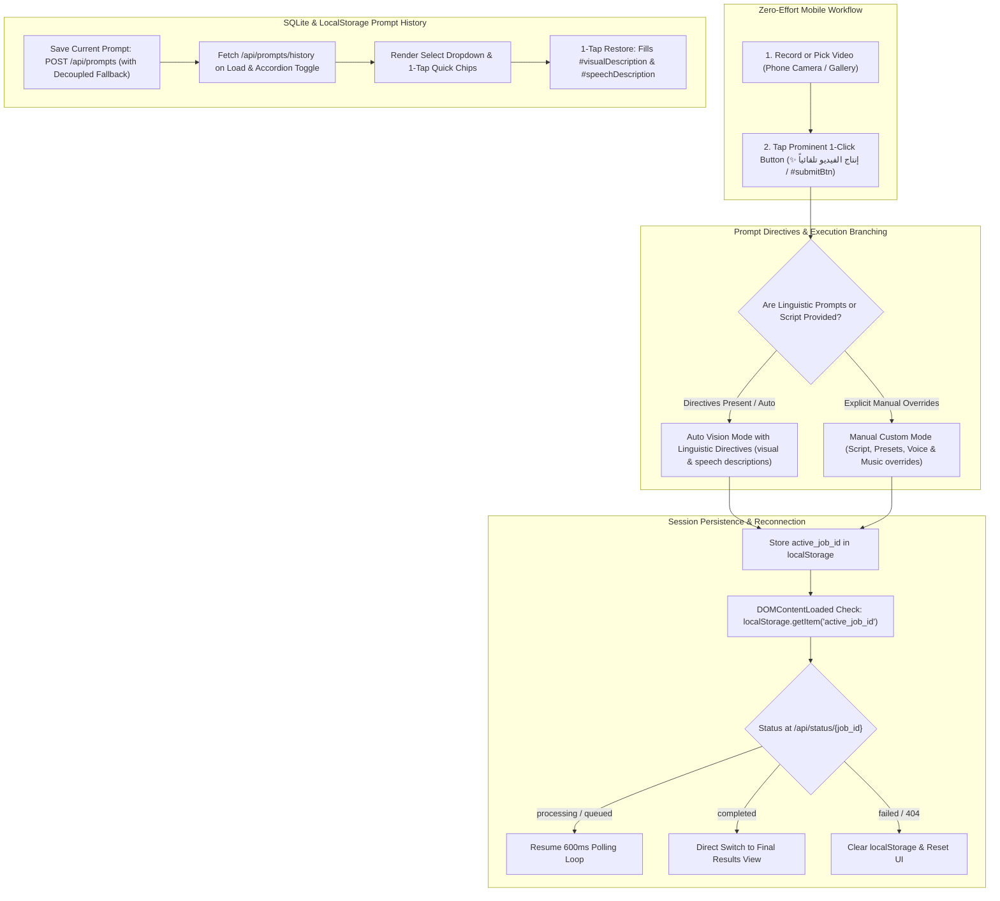

# Mobile Web Front-End & Real Estate UI/UX Studio (`web/static/`)

## 1. Overview & System Mission
The `web/static/` directory houses the client-side architecture for the **Algerian Real Estate Mobile Studio** (`استوديو عقارات الجزائر`). Engineered specifically for mobile smartphone field workflows, this interface empowers Algerian real estate agents, videographers, and property promoters to:
1. **Ultra-Clean 1-Click Mobile UX**: Capture or select phone footage and trigger complete AI post-production with a single prominent tap (**"✨ إنتاج الفيديو تلقائياً بالذكاء الاصطناعي بنقرة واحدة"** or `#submitBtn`).
2. **Linguistic Visual & Speech Intent Prompts**: Express desired visual scenes and voiceover direction in natural Arabic descriptions (e.g., luxury salon tour, balcony sea view, friendly walkthrough tone), passed directly to backend AI agents.
3. **Saved Prompts History & 1-Tap Restoration (SQLite / LocalStorage)**: View, restore, and save linguistic prompt presets with immediate 1-tap chip restoration or select dropdown bindings, backed by `GET /api/prompts/history` and `POST /api/prompts` with decoupled fallback fixtures.
4. **Mobile-Optimized Production Principles Modal**: High-contrast dark theme glassmorphism modal (`#principlesModal`) engineered for smartphone viewports (360px - 430px wide), featuring smooth touch scrolling (`-webkit-overflow-scrolling: touch`), viewport capping (`88vh` / `90vh`), and responsive form controls.
5. **Autonomous Vision & Audio Inference**: When advanced customization is left collapsed/empty, the client sends `auto_mode=true`, letting the backend AI vision agent infer property features, promotional Arabic narration, emotional tone/mood, and matching background music automatically.
6. **Session Persistence & Seamless Reconnection**: Persists in-flight processing jobs across page refreshes, browser reloads, and mobile network disconnects via `localStorage['active_job_id']`. Reconnecting sessions seamlessly resume live 600ms telemetry polling or immediately display the completed marketing cut.
7. **Emotional Tone & Vision Telemetry**: Highlights the AI-inferred emotional atmosphere (e.g. *الحالة الشعورية: فاخر وهادئ*) through dedicated spotlight cards and telemetry badges.
8. **Mobile-First Video Ingestion & Delivery**: Hardware camera capture, in-browser live viewfinder with lens flip, Web Share API distribution, interactive keyframe carousels, and one-tap **"🔄 معالجة فيديو جديد"** session reset.

---

## 2. Itemized File Manifest & Responsibilities

| File | Language / Format | Primary Responsibility |
| :--- | :--- | :--- |
| [`index.html`](file:///home/pluto/projects/lok/web/static/index.html) | Semantic HTML5 (RTL) | 1-Click layout, collapsible advanced accordion with linguistic prompt controls & prompt history restoration, mobile principles modal, native camera inputs, live viewfinder, telemetry stepper, and result playback player. |
| [`style.css`](file:///home/pluto/projects/lok/web/static/style.css) | Modern CSS3 | Emerald & gold luxury dark UI theme, high-contrast dark glassmorphism for principles modal, mobile viewport media queries (360px - 430px), prompt history chips, accordion styling, and responsive touch ergonomics. |
| [`app.js`](file:///home/pluto/projects/lok/web/static/app.js) | Vanilla ES2022 JavaScript | State engine, prompt history fetching & restoration (`/api/prompts/history`), prompt saving (`/api/prompts`), FormData serialization (`visual_description`, `speech_description`), `localStorage` session persistence, automated reconnection lifecycle, and live telemetry polling. |
| [`README.md`](file:///home/pluto/projects/lok/web/static/README.md) | Markdown (English) | Complete architectural documentation, session lifecycle specification, component contract guide, and UI component reference. |

---

## 3. UI Architecture & 1-Click Workflow



### 3.1 1-Click Zero-Effort UX & Submission Logic
- **Primary CTA**: A single luminous button (`#btnProduce` with programmatic alias `#submitBtn`) styled with an emerald-to-gold luxury gradient. It immediately triggers AI video production.
- **FormData Enrichment**: In all production submissions, the client automatically binds:
  - `video`: Selected or recorded MP4/MOV file.
  - `visual_description`: Natural language description of what should appear in the video scenes (`#visualDescription`).
  - `speech_description`: Natural language intent of what should be spoken in the voiceover (`#speechDescription`).
  - `auto_mode=true`: If the accordion is collapsed or empty, instructing the backend AI agents to autonomously handle pacing, vision inference, and narration composition.

### 3.2 Linguistic Prompts & SQLite Saved History
- **Visual Description Control (`#visualDescription`)**:
  - Arabic Label: "وصف ما تريده أن يظهر في الفيديو"
  - Purpose: Linguistic scene description steered by background vision agents (e.g. tour starting from the royal salon, moving to the sea-view terrace, highlighting the modern open kitchen).
- **Speech Intent Control (`#speechDescription`)**:
  - Arabic Label: "وصف ما تريده أن يُقال في التعليق الصوتي"
  - Purpose: Linguistic speech intent guiding Gemini Neural TTS narration (e.g. welcome viewers, explain quiet neighborhood advantages, luxurious finishes, and attractive asking price).
- **History Restoration (`#promptHistorySelect` & `#promptHistoryChips`)**:
  - On page load and accordion expansion (`toggle`), `fetchPromptHistory()` queries `GET /api/prompts/history`.
  - Populates both a select dropdown and 1-tap clickable chips with preview labels.
  - Tapping any chip or selecting from the dropdown instantly restores both visual and speech fields with an animated pulse highlight.
  - Decoupled Fallback: If the backend SQLite endpoint is in progress or unavailable, type-safe fallback fixtures and `localStorage` caching maintain forward momentum without errors.
- **Save Current Prompt (`#btnSavePrompt`)**:
  - Sends `POST /api/prompts` with `{ visual_description, speech_description, title }`.
  - Automatically refreshes the prompt history list upon confirmation.

### 3.3 Mobile-Optimized Production Principles Modal (`#principlesModal`)
- **Smartphone Ergonomics (360px - 430px)**:
  - **Glassmorphism Theme**: High-contrast dark theme with translucent slate card (`rgba(15, 23, 42, 0.96)`), `backdrop-filter: blur(20px)`, and emerald border accents (`rgba(16, 185, 129, 0.4)`).
  - **Touch Scrolling**: Bound with `-webkit-overflow-scrolling: touch` and `overscroll-behavior: contain` to prevent page bounce.
  - **Height Capping**: Constrained to `88vh` (desktop) and `90vh` (mobile) to keep modal header and save/reset action buttons accessible.
  - **Zero Horizontal Overflow**: All fieldsets, selects, sliders, master directive textareas, and chip rows employ `box-sizing: border-box`, `max-width: 100%`, and responsive 1-column layouts on mobile viewports.

### 3.4 Session Persistence & Reconnection Lifecycle
1. **Job Registration**: When `/api/jobs/create` returns `job_id`, `localStorage.setItem('active_job_id', jobId)` is called immediately.
2. **Page Reload & Return**: On `DOMContentLoaded`, `app.js` checks for `active_job_id`:
   - If present, the UI skips the initial upload prompt and reveals `#stepperBox` with real-time status.
   - It queries `GET /api/status/{job_id}`:
     - **`processing` or `queued`**: Seamlessly resumes the 600ms polling timer, updating the 5-step progress bar, message banner, and live AI agent logs.
     - **`completed`**: Immediately renders `#resultSection` with video playback, download buttons, keyframes, and the emotional tone badge.
     - **`failed` or `404`**: Automatically cleans up `localStorage.removeItem('active_job_id')`, presents an informative alert, and resets the interface.
3. **Session Reset ("🔄 معالجة فيديو جديد")**:
   - Prominently placed at the top of the completed results card (`#btnResetNewVideo`) and at the bottom (`#btnStartNewProduction`).
   - Clears `localStorage['active_job_id']`, aborts active polling intervals, clears preview buffers, and scrolls smoothly back to the top.

---

## 4. Design Tokens & Visual Hierarchy (`style.css`)

```css
/* 1-Click Luxury AI Production Gradient */
--btn-1click-bg: linear-gradient(135deg, #047857 0%, #059669 30%, #b45309 70%, #d97706 100%);
--btn-1click-glow: rgba(245, 158, 11, 0.35);

/* High-Contrast Modal Glassmorphism */
--modal-card-bg: rgba(15, 23, 42, 0.96);
--modal-card-border: rgba(16, 185, 129, 0.4);
--modal-backdrop-bg: rgba(3, 7, 18, 0.88);

/* Linguistic Prompt Directives Palette */
--prompt-card-bg: rgba(15, 23, 42, 0.75);
--prompt-border: rgba(245, 158, 11, 0.3);
--prompt-chip-bg: rgba(245, 158, 11, 0.1);
--prompt-chip-text: #fef08a;

/* Emotional Tone Highlight Palette */
--tone-bg: linear-gradient(135deg, rgba(168, 85, 247, 0.15), rgba(245, 158, 11, 0.12));
--tone-border: rgba(168, 85, 247, 0.45);
--tone-text: #e9d5ff;
```

---

## 5. REST API Integration Matrix

| Endpoint | Method | Sent from Frontend | Client Handling |
| :--- | :--- | :--- | :--- |
| `/api/health` | `GET` | None | Updates `#systemStatusChip` indicator. |
| `/api/presets` | `GET` | None | Injects cards into `#presetsSelectorGrid` inside accordion. |
| `/api/music-tracks` | `GET` | None | Injects music options into `#musicSelect`. |
| `/api/principles` | `GET` | None | Loads active production principles into `#principlesModal`. |
| `/api/principles` | `POST` | JSON payload of principles | Saves user principles in backend memory and file storage. |
| `/api/principles/reset` | `POST` | None | Restores factory default production principles. |
| `/api/prompts/history` | `GET` | None | Retrieves saved visual and speech prompt history for 1-tap restore. |
| `/api/prompts` | `POST` | JSON: `visual_description`, `speech_description`, `title` | Persists current prompt to SQLite database / local fallback. |
| `/api/jobs/create` | `POST` | `multipart/form-data`: `video`, `visual_description`, `speech_description`, `auto_mode=true` (if collapsed), optional `script`, `preset`, `voice`, `music` | Stores `job_id` in `localStorage`, initiates 600ms polling. |
| `/api/upload-and-process` | `POST` | `multipart/form-data`: `video`, `visual_description`, `speech_description` | Direct synchronous fallback processing endpoint. |
| `/api/status/{job_id}` | `GET` | `job_id` in URL path | Returns live step, progress percent, logs, and final cut URL + `emotional_tone`. |
| `/outputs/mobile_cuts/*` | `GET` | None | Direct HTML5 video and keyframe image streaming. |
