# lok • Minimalist Studio & Bootstrap Admin Portal Architecture (`web/static/`)

## 1. Executive Summary & Design Mission
The `web/static/` directory provides the client-side user interface for **'lok'** (`منصة إنتاج الفيديو الذكي للتجار والشركات`), following a radical minimalist redesign and a modern high-contrast Black & White monochrome aesthetic.

The platform is structured into two core environments:
1. **Public/Merchant Client UI (`/` -> `index.html`)**:
   - Modern Black & White (`lok`) styling with zero clutter.
   - **Gated Authentication**: Unauthenticated visitors are greeted with a clean login screen before any studio features or controls become visible.
   - **Minimalist Studio ("الواجهة نظيفة وفارغة")**: Keeps strictly essential controls:
     1. Pre-recorded video upload area (dropzone and file picker for ready videos; camera recording streams removed).
     2. Detailed prompt textarea (instructing speech speed, visual scenes, emotional tone, and Algerian Darja/Arabic dialect).
     3. Simple Settings button (`"⚙️ الإعدادات"`) opening a focused settings view with a Back button (`"← العودة للاستوديو"`).
     4. 1-Click Produce Video button (`"✨ إنتاج الفيديو التسويقي"`).
   - **Focused Settings View**:
     - Current balance and remaining quota indicator (daily remaining, weekly remaining, subscription validity).
     - Recommendations Manager (create, edit, delete prompt snippets, and attach directly to the studio prompt).
     - Voiceover Artist Picker with Algerian Darja audition audio player (`ar-XA-Standard-A/B/C/D`).
     - Session Logout button.
2. **Dedicated Bootstrap Admin Portal (`/admin` -> `admin.html`)**:
   - Built with **Bootstrap 5** for mobile and desktop responsiveness.
   - Dedicated administrator login view for credentials `pluto` and `plutosw4`.
   - Complete Accounts Management Table listing: username, business name, category, active/suspended status, start validity date (`valid_from`), expiration date (`expires_at`), daily quota, and weekly quota.
   - Modals for adding new accounts, editing details/quotas, changing passwords, and reviewing historical activity event logs.

---

## 2. File Manifest & Responsibilities

| File | Language / Framework | Primary Responsibility |
| :--- | :--- | :--- |
| [`index.html`](file:///home/pluto/projects/lok/web/static/index.html) | Semantic HTML5 (RTL) | Minimalist 'lok' client UI layout: gated login screen, pre-recorded video dropzone, detailed prompt textarea, produce button, settings modal with Back button, balance meters, recommendations manager, and voiceover Darja audition player. |
| [`style.css`](file:///home/pluto/projects/lok/web/static/style.css) | Modern CSS3 | Black & White monochrome design system: deep black backgrounds (`#09090b`), pure white buttons (`.btn-bw-primary`), dropzone states, custom textareas, settings overlays, and responsive mobile breakpoints. |
| [`app.js`](file:///home/pluto/projects/lok/web/static/app.js) | Vanilla ES2022 JavaScript | Client state engine: session gating, pre-recorded file ingestion, prompt binding, recommendations CRUD and prompt attachment, Darja voice audition playback, quota updates, and video production dispatch. |
| [`admin.html`](file:///home/pluto/projects/lok/web/static/admin.html) | HTML5 / Bootstrap 5 (Standalone CSS) | Dedicated Admin Portal served at `/admin`: standalone embedded CSS design system (zero external CDN dependency), authentication for `pluto` / `plutosw4`, accounts management table, quota configuration, validity dates, password resets, and activity event log viewer. |
| [`README.md`](file:///home/pluto/projects/lok/web/static/README.md) | Markdown (English) | Complete technical documentation, state workflows, user journey diagrams, and REST API integration specifications. |

---

## 3. UI Architecture & Navigation Workflow

```mermaid
flowchart TD
    subgraph ClientSession["Client UI Navigation Flow (lok)"]
        Start(["User Visits /"]) --> CheckToken{"Has Active Session?"}
        CheckToken -->|No| GatedLogin["Gated Login Screen (#loginView)"]
        CheckToken -->|Yes| Studio["Minimalist Studio UI (#studioView)"]

        GatedLogin -->|Submit Credentials / 1-Tap Demo| AuthVerify["Verify Token / Login API"]
        AuthVerify -->|Valid| Studio

        Studio --> Upload["1. Upload Pre-recorded Video (#videoDropzone)"]
        Studio --> Prompt["2. Detailed Prompt (#promptTextarea)"]
        Studio --> SettingsBtn["3. Simple Settings Button (#btnOpenSettings)"]
        Studio --> ProduceBtn["4. Produce Video (#btnProduceVideo)"]

        SettingsBtn --> SettingsModal["Settings View (#settingsModal)"]
        SettingsModal --> BackBtn["Back Button: ← العودة للاستوديو (#btnSettingsBack)"]
        BackBtn --> Studio

        SettingsModal --> Quotas["Current Balance & Quota Display"]
        SettingsModal --> RecManager["Recommendations Manager (CRUD + Attach)"]
        SettingsModal --> VoicePicker["Voiceover Artist Picker & Darja Audition"]
        SettingsModal --> LogoutBtn["Logout Button (#btnLogout)"]

        RecManager -->|Attach Snippet| Prompt
        LogoutBtn --> GatedLogin
    end

    subgraph AdminPortal["Admin Portal Navigation Flow (/admin)"]
        AdminVisit(["Admin Visits /admin"]) --> CheckAdmin{"Admin Logged In?"}
        CheckAdmin -->|No| AdminLogin["Admin Login View (pluto / plutosw4)"]
        CheckAdmin -->|Yes| AdminDash["Admin Dashboard View"]

        AdminLogin -->|Authenticate| AdminDash
        AdminDash --> AccountsTable["Accounts Table (valid_from, expires_at, quotas)"]
        AdminDash --> AddModal["Add Account Modal"]
        AdminDash --> EditModal["Edit Account Modal"]
        AdminDash --> PassModal["Change Password Modal"]
        AdminDash --> LogsModal["Activity Event Logs Modal"]
        AdminDash --> AdminLogout["Logout"] --> AdminLogin
    end
```

---

## 4. 'lok' Studio UI Details

### A. Pre-Recorded Video Upload Area
- Clean drag-and-drop zone (`#videoDropzone`) with hidden `<input type="file" id="videoFileInput" accept="video/*">`.
- Dedicated exclusively to pre-recorded / phone camera video files (MP4, MOV, WebM).
- In-browser live camera recording controls and viewfinder elements have been eliminated to ensure pure zero-friction simplicity.
- Automatically computes and displays video file name, size (MB), and format.

### B. Detailed Prompt Input
- Generous, high-contrast textarea (`#promptTextarea`) guiding merchants to define:
  1. **Speech Speed (`سرعة الإلقاء`)**: Dynamic pacing vs. calm measured delivery.
  2. **Visual Scenes (`المشاهد المرئية`)**: Architectural highlights, interior lighting, exterior facades, product closeups.
  3. **Tone (`نبرة الصوت`)**: Prestigious commercial, warm and inviting, or high-energy youth.
  4. **Dialect (`اللهجة`)**: Algerian Darja (Algiers, Oran, Constantine) or Modern Standard Arabic.
- Integrated indicator chip (`#attachedRecIndicator`) showing active attached recommendation template.

### C. Settings View with Back Button
Accessible via `#btnOpenSettings` and dismissible via `#btnSettingsBack` (`"← العودة للاستوديو"`):
1. **Balance & Quota Indicator**:
   - Daily videos remaining / total (`#quotaDailyRemaining` / `#quotaDailyTotal`).
   - Weekly videos remaining / total (`#quotaWeeklyRemaining` / `#quotaWeeklyTotal`).
   - Active subscription validity date (`#quotaExpiryText`).
   - High-contrast visual progress meter (`#quotaMiniBarFill`).
2. **Recommendations Manager ("التوصيات")**:
   - Manage reusable prompt snippets.
   - **Create**: Add new recommendation with instant persistence.
   - **Edit**: Inline modal prompt to edit recommendation text.
   - **Delete**: Remove obsolete recommendation.
   - **Attach (`🎯 تطبيق في التوجيه`)**: Instantly populates the recommendation text into `#promptTextarea`, shows confirmation feedback, and returns smoothly to the studio view.
3. **Voiceover Artist Picker**:
   - Selection of 4 neural voice models:
     - `ar-XA-Standard-A`: Aisha (warm female tone in Algerian Darja).
     - `ar-XA-Standard-B`: Amine (authoritative male tone in Algerian Darja).
     - `ar-XA-Standard-C`: Karim (dynamic youth male tone in Algerian Darja).
     - `ar-XA-Standard-D`: Meriem (elegant female tone in Algerian Darja).
   - Audio Audition Player (`"▶ عينة صوتية بالدارجة"`): Plays real audio sample streamed from `/api/voices/{voice_id}/sample` with Web Audio harmonic synth fallback if offline.
4. **Session Logout**:
   - Invalidates local credentials and smoothly resets interface to the gated login view.

### D. Gated Client Login UX & Production Pipeline Integration
- **Whitespace Sanitation**: Automatically trims leading and trailing whitespace from username and password inputs.
- **Keyboard Navigation**: Full support for `Enter` key submission across input fields.
- **User-Friendly Error Feedback**: Clear visual alerts in Arabic distinguishing 401 ("اسم المستخدم أو كلمة المرور غير صحيحة") from 403 ("الحساب معطل أو منتهي الصلاحية").
- **Quick Credentials Helpers**: Direct display of credentials for master administrator (`pluto` / `plutosw4`) and demo merchant accounts (`merchant_realestate`), alongside 1-tap quick login buttons.
- **Dual Session Persistence**: Stores `session_token` and `auth_token` simultaneously across `localStorage` and `document.cookie` (`path=/; max-age=604800; SameSite=Lax`), ensuring smooth multi-tab consistency and API compatibility.
- **Robust Video Production Dispatch**: Enforces authenticated requests sending `Authorization: Bearer <token>` and `credentials: 'include'` for both `/api/jobs/create` and `/api/upload-and-process`, with real-time multistep progress feedback.

### E. Dynamic Video Playback, Cache-Busting & Real-Time Stepper Pipeline
- **Dynamic Video Source Resolution**:
  - The video player (`#resultVideo`) never hardcodes `/outputs/final_cut.mp4` as the sole video source.
  - Dynamically inspects the backend response: `data.video_url || data.output_video_url || data.output_video || data.result?.video_url || data.result?.output_video_url || '/outputs/final_cut.mp4'`.
- **Cache-Busting URL Construction (`?v=Date.now()`)**:
  - Appends a high-precision timestamp parameter (`?v=${Date.now()}`) to the resolved video source URL.
  - Guarantees that mobile browsers (iOS Safari, Android Chrome) and desktop clients bypass HTTP 304 Not Modified caches and immediately play the newly generated cut.
  - Dynamically updates `#btnDownloadVideo` (with dedicated download filename `lok_<job_id>.mp4`) and the direct video share link `#btnShareVideo`.
- **Real-Time Backend Telemetry Stepper (`#processingStepper`)**:
  - Dynamically maps telemetry events from `/api/status/{job_id}` across five processing stages:
    1. **Extracting Frames (`#stepFrames`)**: Video format probing and keyframe extraction.
    2. **Vision AI Analysis (`#stepAnalyze`)**: Architectural & product scene analysis via multimodal AI.
    3. **Speech Generation (`#stepVoice`)**: Algerian Darja neural TTS narration synthesis.
    4. **Video Rendering (`#stepRender`)**: Audio-video assembly, ducking, and rendering.
    5. **Annotations (`#stepAnnotations`)**: Marketing badges, textual overlays, and final packaging.
- **Strict Completion Gating**:
  - Polling keeps the progress indicator active and guards against prematurely revealing the result container (`#resultContainer`) or setting `video.src` until the backend explicitly returns `status === 'completed'` or progress reaches 100%.

### F. Generated Script Inspection, Synchronized Captions & Shot-by-Shot Timeline
- **Prompt Guidance & Freeform Creative Controls**:
  - `#promptTextarea` provides an enhanced placeholder and guidance hint (`#promptInputHint`) informing merchants that they can write freeform instructions:
    - **Synchronized Captions & Subtitles**: Precise sentence-by-sentence subtitle synchronization matching narration cadence (e.g. `"ترجمة متزامنة لكلام المعلق كلمة بكلمة"`).
    - **Shot-by-Shot Grounding & Anti-Hallucination**: Grounding video narration strictly into the visible scenes, camera transitions, and rooms without hallucinating absent amenities.
    - **Background Music Control**: Muting background music entirely via `"بدون موسيقى"` (or `"كتم الموسيقى"`) for 100% clean voiceover, or specifying volume levels (e.g. `"موسيقى بيانو بمستوى 15%"`).
    - **Font Sizing & Prominence**: Requesting large visible text via `"بخط كبير وواضح"` or `"بخط عريض وبارز"`.
    - **Property Specifications**: Weaving architectural details into the narrative (e.g. `"شقة F5 مطلة على البحر"`).
    - **Persistent Bottom Text & Contact**: Adding merchant contact numbers (e.g. `"مع إظهار رقم الهاتف 0558815453 أسفل الفيديو"`).
    - **Montage & Trimming**: Specifying clip durations and interval cuts.
- **Generated Script Inspection Card (`#generatedScriptCard`)**:
  - Displayed inside `#resultCard` upon successful job completion.
  - Presents the composed narration script generated by the AI (`data.script` / `data.inferred_script`) with proper formatting and typography.
  - Features a 1-click Copy button (`#btnCopyScript`) utilizing `navigator.clipboard` (with textarea fallback) and temporary confirmation toast and button label feedback (`تم النسخ ✓`).
- **Synchronized Captions Feedback Pill (`#resultCaptionsPill`)**:
  - Informs merchants of subtitle sync status and segment count (e.g. `"ترجمة متزامنة مع الصوت (12 مقطع متزامن)"`).
  - Displays dynamic badges indicating sync mode (e.g. `"متزامنة بالكامل"` or `"حسب المشاهد"`).
- **Shot-by-Shot Synchronized Timeline (`#shotsTimelineSection`)**:
  - Positioned directly inside `#generatedScriptCard` under the script narration block.
  - Shows total scene count badge (`#timelineBadge`), e.g. `"4 مشاهد متزامنة"`.
  - Itemized timeline list (`#shotsTimelineList`) featuring:
    - Keyframe scene thumbnail (`.shot-thumb-img` with timestamp overlay).
    - Timestamp range badge (`.shot-timestamp`), e.g. `[00:00 - 00:04]`.
    - Scene title, description, or subtitle text (`.shot-title-text`, `.shot-narr-text`).
    - Visual tags for detected amenities or property areas (`.shot-tag`).
- **Music & Sound Mixing Feedback Pill (`#resultMusicPill`)**:
  - Displays background music status and audio balance dynamically:
    - **Muted State**: `"صوت نقي 100% (تم كتم وإلغاء موسيقى الخلفية بالكامل)"` with mute icon `🔇` and emerald high-contrast badge.
    - **Active Music State**: Shows track title and volume percentage, e.g. `"بيانو فاخر (مستوى الصوت: 16%)"`.
- **Persistent Overlay Feedback Pill & Badges (`#resultOverlayPill`)**:
  - When persistent bottom text or a merchant phone number (`data.bottom_text` / `data.phone_number` / `data.fixed_text`) is applied to the video, an informative high-contrast pill is displayed (e.g. `📞 الشريط السفلي: 0558815453`).
  - **Large Font Badge (`#overlayFontBadge`)**: Highlights `"🔍 بخط كبير وواضح"` when large font styling is applied.
  - **Property Specs Badge (`#propertySpecsBadge`)**: Highlights extracted property specifications, e.g. `"🏡 F5 • مطل على البحر"`.

---

## 5. Bootstrap Admin Portal (`/admin` -> `admin.html`)

### A. Dedicated Authentication
- Standard credentials: **`pluto`** / **`plutosw4`**.
- Accessible directly at `/admin` or `/static/admin.html`.

### B. Accounts Management Table
Responsive Bootstrap 5 dark table (`#accountsTable`):
- **User ID**: System numeric identifier.
- **Username**: Unique tenant handle (`dar_al_nokhba`, `auto_algerie`, etc.).
- **Business Name**: Commercial brand or company name.
- **Category**: Sector taxonomy badge.
- **Status**: Live status badge (`Active` / `Suspended`).
- **Validity Start Date (`valid_from`)**: Account initiation / subscription commencement.
- **Expiration Date (`expires_at`)**: Subscription termination date.
- **Daily Quota**: Current usage vs. daily limit.
- **Weekly Quota**: Current usage vs. weekly limit.
- **Action Buttons**:
  - `✏️ تعديل`: Modifies business name, category, quotas, validity dates, and status.
  - `🔑 كلمة المرور`: Resets account password.
  - `📜 السجل`: Opens the chronological activity event logs modal.
  - `تبديل الحالة`: Instantly toggles between Active and Suspended states.

### C. Activity Event Log Viewer Modal
Displays timestamped historical actions for any tenant:
- Account creation and initial quota allocation.
- Subscription renewals and quota revisions.
- Password change events.
- Video generation dispatches and completed cuts.
- Administrative status overrides.

### D. Standalone Embedded CSS & Offline Resiliency
- **Self-Contained Rendering**: All Bootstrap 5 layout rules, responsive grid, reset, typography, cards, badges, buttons, form controls, alerts, and modals are embedded directly into a `<style>` block within `admin.html`.
- **Zero External CDN Reliance**: The admin portal renders with full high-fidelity visual styling in isolated offline environments without requiring internet access or CDN availability.
- **Native Modal & Toast Polyfill**: Built-in fallback in pure vanilla JavaScript ensures modals and toasts function seamlessly even if external JavaScript bundles cannot be retrieved.

---

## 6. REST API Integration Matrix

| Endpoint | Method | Caller | Payload / Headers | Responsibility |
| :--- | :--- | :--- | :--- | :--- |
| `/admin` | `GET` | Browser | None | Serves the Bootstrap 5 Admin Portal (`admin.html`). |
| `/api/auth/login` | `POST` | Client UI | JSON: `username`, `password` | Authenticates merchant and creates session token. |
| `/api/auth/logout` | `POST` | Client / Admin | `Authorization: Bearer <token>` | Invalidation of active session. |
| `/api/auth/session` | `GET` | Client UI | `Authorization: Bearer <token>` | Reconnects existing session on page load. |
| `/api/admin/login` | `POST` | Admin Portal | JSON: `username`, `password` (`pluto` / `plutosw4`) | Authenticates administrator. |
| `/api/admin/accounts` | `GET` | Admin Portal | `Authorization: Bearer <token>` | Retrieves full list of merchant accounts. |
| `/api/admin/accounts` | `POST` | Admin Portal | JSON: account fields & quotas | Registers new merchant account. |
| `/api/admin/accounts/{id}` | `PATCH` | Admin Portal | JSON: quota, status, dates | Updates merchant account metadata and quotas. |
| `/api/admin/accounts/{id}/logs`| `GET` | Admin Portal | `Authorization: Bearer <token>` | Retrieves chronological activity events for tenant. |
| `/api/voices/{id}/sample` | `GET` | Client UI | `voice_id` parameter | Streams Algerian Darja audio sample for audition. |
| `/api/jobs/create` | `POST` | Client UI | `multipart/form-data`: `video`, `script`, `voice` | Dispatches video production job. |
| `/api/status/{job_id}` | `GET` | Client UI | `job_id` parameter | Live status polling for production job. |

---

## 7. Strict Character Mapping Compliance
As mandated by platform directives, all text, comments, documentation, and HTML/CSS/JS code maintain strict typography standards with **zero occurrences of the forbidden character U+0669**.
