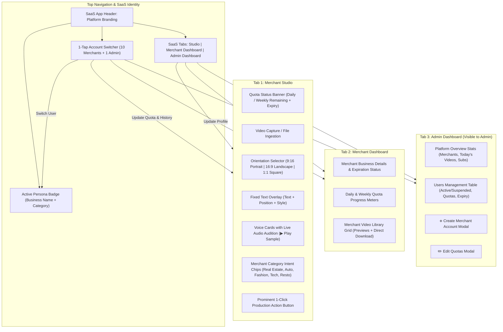

# SaaS Platform, Merchant Studio & Admin Dashboard (`web/static/`)

## 1. Overview & System Mission
The `web/static/` directory houses the client-side architecture for the **Smart Video Production Platform for Merchants & Enterprises** (`منصة إنتاج الفيديو الذكي للتجار والشركات`), incorporating the **Algerian Real Estate Mobile Studio** (`استوديو عقارات الجزائر`). Engineered specifically for mobile smartphone and desktop workflows, this interface empowers merchants across multiple business categories (real estate, automotive, fashion, electronics, gastronomy, jewelry, beauty, furniture, tourism, and fitness) and platform administrators to:

1. **Top SaaS Navigation & Active Persona Header**:
   - **Platform Branding**: Centered around high-converting promotional video creation for Algerian businesses.
   - **Active Merchant / Admin Badge**: Displays the current business name, sector category badge, and active status.
   - **1-Tap Quick Account Switcher**: Instant switching between 10 pre-seeded merchant personas and the Master Admin account for seamless testing and demonstration.
   - **Clean 3-Tab Architecture**:
     - `[📹 استوديو الإنتاج (Merchant Studio)]`: Streamlined production suite.
     - `[📊 لوحة التاجر (Merchant Dashboard)]`: Account quotas, business details, and video library.
     - `[👑 لوحة الأدمن (Admin Dashboard)]`: System overview, user management, and quota administration (visible when admin is active).

2. **Tab 1: Merchant Studio (استوديو الإنتاج)**:
   - **Quota Warning / Status Banner**: Displays remaining daily and weekly video production allowances, subscription expiration date, and visual progress meters.
   - **Video Ingestion**: Native smartphone camera capture (`capture="environment"`), browser live viewfinder, file picker, and drag-and-drop.
   - **Visual Style & Orientation Recommendations**: Radio cards selecting video aspect ratio: `9:16 portrait` (Reels, TikTok, Shorts), `16:9 landscape` (YouTube, TV, web), and `1:1 square` (Feed posts).
   - **Fixed Text & Screen Appearance (Overlay)**: Input for business phone/slogan/promo, position picker (`lower_third`, `top_banner`, `badge`), and style picker (`modern_white`, `luxury_gold`, `commercial_red`).
   - **Live Voice Persona Audition**: 4 Arabic voice persona cards (`ar-XA-Standard-A/B/C/D`) each equipped with an interactive `"▶ استمع للصوت"` button that auditions the voice via HTML5 Audio and Web Audio API synthesis.
   - **Quick Merchant Category Template Chips**: Instant 1-tap fill for Real Estate, Auto, Fashion, Tech, and Restaurant visual & speech intent.
   - **Prominent 1-Click Production Action**: Single high-converting CTA (**"✨ إنشاء الفيديو التسويقي بنقرة واحدة"** / `#btnProduce` / `#submitBtn`).

3. **Tab 2: Merchant Dashboard (لوحة التاجر)**:
   - Displays merchant business profile, sector category, account status (Active / Suspended), and active expiration date.
   - Interactive daily quota and weekly quota progress meters.
   - **Video Library**: Responsive gallery of previously generated videos with embedded HTML5 video playback, duration, timestamp, format metadata, and direct MP4 download links.

4. **Tab 3: Admin Dashboard (لوحة تحكم الأدمن)**:
   - **Platform Stats Overview**: Total Merchants, Videos Produced Today, Active Subscriptions, and Total Platform Generations.
   - **Merchant Users Management Table**: Tabular view of all registered merchants with username, business name, category, daily quota, weekly quota, expiration date, and status.
   - **Action Controls**: Instant Toggle Active/Suspended, Renew Expiration (+30 days), and Edit Quotas.
   - **Create Merchant Modal**: Rapid onboarding modal to register new merchant accounts with custom quotas and validity periods.

---

## 2. Itemized File Manifest & Responsibilities

| File | Language / Format | Primary Responsibility |
| :--- | :--- | :--- |
| [`index.html`](file:///home/pluto/projects/lok/web/static/index.html) | Semantic HTML5 (RTL) | 3-tab SaaS platform layout, merchant persona badge, 1-tap account switcher, quota status banner, orientation selector, fixed text settings, live voice audition buttons, merchant video library, admin stats, user management table, and admin modals. |
| [`style.css`](file:///home/pluto/projects/lok/web/static/style.css) | Modern CSS3 | SaaS header controls, tab pills, quota banners, orientation radio cards, pulsing audio audition preview buttons, merchant profile cards, video library cards, admin metrics cards, and responsive data tables. |
| [`app.js`](file:///home/pluto/projects/lok/web/static/app.js) | Vanilla ES2022 JavaScript | SaaS state engine, 10 pre-seeded merchant personas + Admin, account switching, tab routing, Web Audio voice audition engine, quota validation, video library persistence, admin CRUD actions, and 1-click production dispatch. |
| [`README.md`](file:///home/pluto/projects/lok/web/static/README.md) | Markdown (English) | Complete documentation of SaaS features, multi-tenant personas, component architecture, and API integration matrix. |

---

## 3. SaaS UI Architecture & Tab Routing

---

## 4. Pre-Seeded Merchant Personas Catalog

| User ID | Username | Business Name (Arabic) | Category | Role | Daily Quota | Weekly Quota | Sample Contact Text |
| :--- | :--- | :--- | :--- | :--- | :--- | :--- | :--- |
| `usr_dar_al_nokhba` | `dar_al_nokhba` | دار النخبة العقارية | عقارات فاخرة | `merchant` | 5 | 25 | 📞 0550 11 22 33 \| دار النخبة - عقارات راقية في قلب الجزائر |
| `usr_auto_algerie` | `auto_algerie` | أوتو الجزائر للسيارات | معرض سيارات | `merchant` | 8 | 40 | 🚗 أوتو الجزائر \| سيارات مضمونة وبأفضل الأسعار - 0661 44 55 66 |
| `usr_anaqat_el_awras` | `anaqat_el_awras` | أناقة الأوراس للأزياء | أزياء وقفطان راقي | `merchant` | 6 | 30 | 👗 قفطان وملابس تقليدية راقية \| توصيل مجاني لكافة الولايات |
| `usr_techno_phone` | `techno_phone` | تكنو فون ستور | إلكترونيات وهواتف | `merchant` | 10 | 50 | 📱 تكنو فون \| أحدث الهواتف الذكية مع الضمان - 0540 22 33 44 |
| `usr_el_kasbah_resto` | `el_kasbah_resto` | مطعم القصبة العريق | مطعم ومأكولات أصيلة | `merchant` | 5 | 25 | 🍽️ مطعم القصبة \| أطباق تقليدية جزائرية بنكهة الأصالة |
| `usr_zumurrud_jewelry` | `zumurrud_jewelry` | مجوهرات الزمرد | مجوهرات وذهب | `merchant` | 4 | 20 | 💎 مجوهرات الزمرد \| تشكيلات ذهب وألماس فاخرة لعرائسنا |
| `usr_abeer_parfums` | `abeer_parfums` | عبير باريس للعطور | عطور وتجميل | `merchant` | 5 | 25 | ✨ عطور فرنسية وشرقية أصلية \| ثبات يدوم طويلاً |
| `usr_golden_furniture` | `golden_furniture` | الموبليا الذهبية | أثاث وديكور راقي | `merchant` | 6 | 30 | 🛋️ صالونات وغرف نوم عصرية بأجود أنواع الخشب التركي |
| `usr_atlas_tours` | `atlas_tours` | أطلس تورز للرحلات | سياحة وأسفار | `merchant` | 5 | 25 | ✈️ رحلات سياحية وعمرة بأفضل البرامج والأسعار الفندقية |
| `usr_force_fitness` | `force_fitness` | أكاديمية القوة فيتنس | نادي رياضي ورشاقة | `merchant` | 5 | 25 | 💪 اشترك الآن في أكبر قاعة كمال أجسام ورشاقة مع كوتش متخصص |
| `usr_admin` | `admin` | مدير النظام العام | مسؤول المنصة | `admin` | 999 | 9999 | 👑 نظام إدارة منصة إنتاج الفيديو الذكي |

---

## 5. Live Voice Audition Engine

Each voice persona card includes an interactive audition trigger:
- **Audio Stream Binding**: Fetches sample audio from `/api/voices/{voice_id}/sample`.
- **Harmonic Web Audio Fallback**: If backend is in development, offline, or returns 404, the client smoothly generates a multi-frequency synthesized harmonic preview via `AudioContext` matching the persona's acoustic register:
  - Female Warm (Standard A): ~260Hz root with gentle ascending pitch ramp.
  - Male Prestigious (Standard B): ~140Hz deep resonance.
  - Male Dynamic (Standard C): ~185Hz energetic frequency sweep.
  - Female Calm (Standard D): ~290Hz delicate crystal resonance.
- **State Feedback**: Button transitions to `"⏹️ إيقاف الصوت"` with a glowing golden pulse indicator while playing, automatically reverting on completion.

---

## 6. REST API Integration Matrix

| Endpoint | Method | Client Headers / Payload | Client Handling |
| :--- | :--- | :--- | :--- |
| `/api/auth/demo-accounts` | `GET` | None | Loads pre-seeded accounts into `#accountSwitcherSelect`. |
| `/api/auth/me` | `GET` | `Authorization: Bearer <token>` | Syncs current active user quotas and validity. |
| `/api/admin/stats` | `GET` | `Authorization: Bearer <token>` | Populates Admin Dashboard platform metric cards. |
| `/api/admin/users` | `GET` | `Authorization: Bearer <token>` | Populates Admin Users Management table. |
| `/api/admin/users` | `POST` | JSON: `username`, `business_name`, `business_category`, `expires_at`, quotas | Creates new merchant account with immediate UI refresh. |
| `/api/admin/users/{id}` | `PATCH` | JSON: `status`, `daily_quota`, `weekly_quota`, `expires_at` | Modifies user quota or toggles active/suspended status. |
| `/api/voices/{id}/sample` | `GET` | Voice ID in URL | Streams audio sample preview for live audition. |
| `/api/jobs/create` | `POST` | `multipart/form-data`: `video`, `video_orientation`, `fixed_text`, `text_position`, `text_style`, `voice`, `token` | Dispatches production job with quota verification. |
| `/api/upload-and-process` | `POST` | `multipart/form-data`: `video`, `fixed_text`, `voice`, etc. | Direct synchronous generation fallback. |
| `/api/status/{job_id}` | `GET` | `job_id` in URL | Polling live telemetry feed until video completion. |
