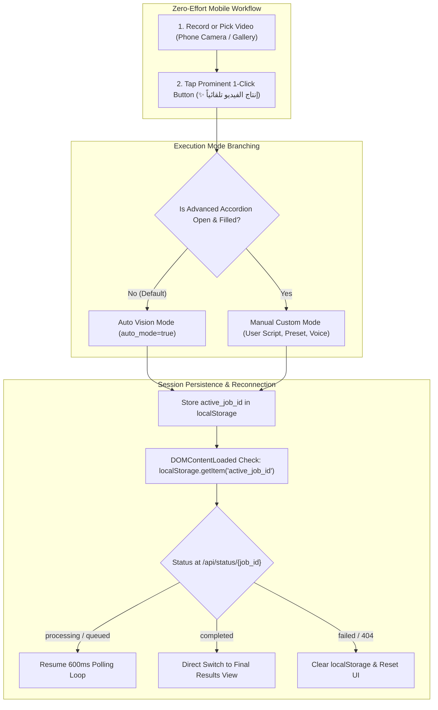

# Mobile Web Front-End & Real Estate UI/UX Studio (`web/static/`)

## 1. Overview & System Mission
The `web/static/` directory houses the client-side architecture for the **Algerian Real Estate Mobile Studio** (`استوديو عقارات الجزائر`). Engineered specifically for mobile smartphone field workflows, this interface empowers Algerian real estate agents, videographers, and property promoters to:
1. **Ultra-Clean 1-Click Mobile UX**: Capture or select phone footage and trigger complete AI post-production with a single prominent tap (**"✨ إنتاج الفيديو تلقائياً بالذكاء الاصطناعي بنقرة واحدة"**).
2. **Autonomous Vision & Audio Inference**: When advanced customization is left collapsed/empty, the client sends `auto_mode=true`, letting the backend AI vision agent infer property features, promotional Arabic narration, emotional tone/mood, and matching background music automatically.
3. **Session Persistence & Seamless Reconnection**: Persists in-flight processing jobs across page refreshes, browser reloads, and mobile network disconnects via `localStorage['active_job_id']`. Reconnecting sessions seamlessly resume live 600ms telemetry polling or immediately display the completed marketing cut.
4. **Emotional Tone & Vision Telemetry**: Highlights the AI-inferred emotional atmosphere (e.g. *الحالة الشعورية: فاخر وهادئ*) through dedicated spotlight cards and telemetry badges.
5. **Mobile-First Video Ingestion & Delivery**: Hardware camera capture, in-browser live viewfinder with lens flip, Web Share API distribution, interactive keyframe carousels, and one-tap **"🔄 معالجة فيديو جديد"** session reset.

---

## 2. Itemized File Manifest & Responsibilities

| File | Language / Format | Primary Responsibility |
| :--- | :--- | :--- |
| [`index.html`](file:///home/pluto/projects/lok/web/static/index.html) | Semantic HTML5 (RTL) | 1-Click layout, collapsible advanced accordion, native camera inputs, live viewfinder, telemetry stepper, and result playback player. |
| [`style.css`](file:///home/pluto/projects/lok/web/static/style.css) | Modern CSS3 | Emerald & gold luxury dark UI theme, 1-click glowing button styles, accordion transition animations, and responsive touch ergonomics. |
| [`app.js`](file:///home/pluto/projects/lok/web/static/app.js) | Vanilla ES2022 JavaScript | State engine, `localStorage` session persistence, automated reconnection lifecycle, 600ms polling, and emotional tone display. |
| [`README.md`](file:///home/pluto/projects/lok/web/static/README.md) | Markdown (English) | Complete architectural documentation, session lifecycle specification, and UI component reference. |

---

## 3. UI Architecture & 1-Click Workflow



### 3.1 1-Click Zero-Effort UX
- **Primary CTA**: A single luminous button (`.btn-produce-1click`) styled with an emerald-to-gold luxury gradient. It immediately triggers AI video production without requiring the user to type text or pick presets.
- **Collapsible Advanced Accordion (`#advancedAccordion`)**:
  - Implemented using native semantic `<details>` and `<summary>` elements.
  - Titled: **"⚙️ تخصيص متقدم (اختياري - يحدده الذكاء الاصطناعي تلقائياً)"**.
  - Houses the Algerian real estate presets grid, the custom script textarea with live speech analytics, the voice persona dropdown (Gemini TTS), and the royalty-free music selector.
  - When left collapsed or empty, `app.js` automatically passes `auto_mode=true` in `FormData`, enabling end-to-end AI vision analysis.

### 3.2 Session Persistence & Seamless Reconnection Lifecycle
1. **Job Registration**: When `/api/jobs/create` returns `job_id`, `localStorage.setItem('active_job_id', jobId)` is called immediately.
2. **Page Reload & Return**: On `window.addEventListener('DOMContentLoaded', ...)`, `app.js` checks for `active_job_id`:
   - If present, the UI skips the initial upload prompt and reveals `#stepperBox` with real-time status.
   - It queries `GET /api/status/{job_id}`:
     - **`processing` or `queued`**: Seamlessly resumes the 600ms polling timer, updating the 5-step progress bar, message banner, and live AI agent logs.
     - **`completed`**: Immediately renders `#resultSection` with video playback, download buttons, keyframes, and the emotional tone badge.
     - **`failed` or `404`**: Automatically cleans up `localStorage.removeItem('active_job_id')`, presents an informative alert, and resets the interface.
3. **Session Reset ("🔄 معالجة فيديو جديد")**:
   - Prominently placed at the top of the completed results card (`#btnResetNewVideo`) and at the bottom (`#btnStartNewProduction`).
   - Clears `localStorage['active_job_id']`, aborts active polling intervals, clears preview buffers, and scrolls smoothly back to the top.

### 3.3 Emotional Tone & Vision Telemetry Display
- When the backend Vision AI model analyzes video keyframes, it determines the listing's emotional atmosphere (e.g. *فاخر وهادئ*, *عصري وحيوي*, *تجاري نشط*).
- **Spotlight Banner (`#emotionalToneSpotlight`)**: Rendered in a glowing purple/gold gradient displaying:
  `الرؤية والحالة الشعورية للذكاء الاصطناعي: [الحالة الشعورية]`
- **Telemetry Chip**: Rendered in `#telemetryBadgesGrid` as:
  `🎭 الحالة الشعورية: [emotional_tone]`

---

## 4. Design Tokens & Visual Hierarchy (`style.css`)

```css
/* 1-Click Luxury AI Production Gradient */
--btn-1click-bg: linear-gradient(135deg, #047857 0%, #059669 30%, #b45309 70%, #d97706 100%);
--btn-1click-glow: rgba(245, 158, 11, 0.35);

/* Emotional Tone Highlight Palette */
--tone-bg: linear-gradient(135deg, rgba(168, 85, 247, 0.15), rgba(245, 158, 11, 0.12));
--tone-border: rgba(168, 85, 247, 0.45);
--tone-text: #e9d5ff;

/* Accordion Component Tokens */
--accordion-bg: var(--card-bg-elevated);
--accordion-summary-bg: rgba(15, 23, 42, 0.55);
```

---

## 5. REST API Integration Matrix

| Endpoint | Method | Sent from Frontend | Client Handling |
| :--- | :--- | :--- | :--- |
| `/api/health` | `GET` | None | Updates `#systemStatusChip` indicator. |
| `/api/presets` | `GET` | None | Injects cards into `#presetsSelectorGrid` inside accordion. |
| `/api/music-tracks` | `GET` | None | Injects music options into `#musicSelect`. |
| `/api/jobs/create` | `POST` | `multipart/form-data`: `video`, `auto_mode=true` (if collapsed), optional `script`, `preset`, `voice`, `music` | Stores `job_id` in `localStorage`, initiates 600ms polling. |
| `/api/status/{job_id}` | `GET` | `job_id` in URL path | Returns live step, progress percent, logs, and final cut URL + `emotional_tone`. |
| `/outputs/mobile_cuts/*` | `GET` | None | Direct HTML5 video and keyframe image streaming. |
