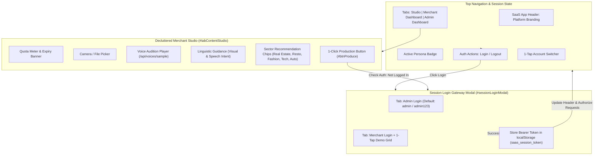

# SaaS Platform, Merchant Studio, Session Login Gateway & Admin Dashboard (`web/static/`)

## 1. Overview & System Mission
The `web/static/` directory houses the client-side architecture for the **Smart Video Production Platform for Merchants & Enterprises** (`منصة إنتاج الفيديو الذكي للتجار والشركات`), incorporating the **Decluttered Commercial Studio** and **Professional Session Login Gateway**. Engineered specifically for mobile smartphone and desktop workflows, this interface empowers merchants across multiple business categories (real estate, automotive, fashion, electronics, gastronomy, jewelry, beauty, furniture, tourism, and fitness) and platform administrators to:

1. **Top SaaS Navigation & Authenticated Header Controls**:
   - **Platform Branding**: Centered around high-converting promotional video creation for Algerian businesses.
   - **Active Persona Badge**: Displays the current logged-in business name, sector category badge, and active status.
   - **Session Authentication Gateway**:
     - Fast login trigger button (**"🔐 تسجيل الدخول"** / `#btnOpenLoginModal`) when unauthenticated.
     - Fast logout trigger button (**"🚪 تسجيل الخروج"** / `#btnLogout`) with session termination.
   - **1-Tap Quick Account Switcher**: Instant switching between 10 pre-seeded merchant personas and the Master Admin account for testing.
   - **Clean 3-Tab Architecture**:
     - `[📹 استوديو الإنتاج (Merchant Studio)]`: Decluttered production suite.
     - `[📊 لوحة التاجر (Merchant Dashboard)]`: Account quotas, business details, and video library.
     - `[👑 لوحة الأدمن (Admin Dashboard)]`: System overview, user management, and quota administration (visible when admin is active).

2. **Tab 1: Decluttered Merchant Studio (استوديو الإنتاج)**:
   - **Decluttering of Legacy Controls**: Removed/hidden real estate presets (`#presetSection`) and verbatim script textareas (`#customScriptContainer` / `#scriptText`) using `display: none !important;` so users are never overloaded with redundant technical fields, while preserving backward-compatibility for legacy test harnesses.
   - **Highlighted Linguistic Guidance Controls**:
     - **Visual Scene Linguistic Guidance** (`#visualDescription`): `"وصف المشهد المرئي المطلوب"` with emerald badge `"توجيه مرئي ذكي"`.
     - **Speech Intent & Tone Guidance** (`#speechDescription`): `"وصف النبرة وفحوى ما سيقال"` with gold badge `"توجيه نبرة وليس نصاً حرفياً"`.
   - **Diverse Commercial Recommendation Chips**: Quick 1-tap template chips for Real Estate (`#chipRealEstate`), Restaurant (`#chipRestaurant`), Fashion (`#chipFashion`), Tech (`#chipTech`), and Auto (`#chipAuto`).
   - **Quota Warning / Status Banner**: Displays remaining daily and weekly video allowances, subscription expiration date, and visual meters.
   - **Video Ingestion**: Native smartphone camera capture (`capture="environment"`), browser live viewfinder, file picker, and drag-and-drop.
   - **Visual Style & Orientation Recommendations**: Radio cards selecting video aspect ratio: `9:16 portrait` (Reels, TikTok, Shorts), `16:9 landscape` (YouTube, TV, web), and `1:1 square` (Feed posts).
   - **Fixed Text & Screen Appearance (Overlay)**: Input for business phone/slogan/promo, position picker (`lower_third`, `top_banner`, `badge`), and style picker (`modern_white`, `luxury_gold`, `commercial_red`).
   - **Live Voice Persona Audition**: 4 Arabic voice persona cards (`ar-XA-Standard-A/B/C/D`) with prominent `"▶ استمع للصوت"` buttons auditioning via `/api/voices/{voice_id}/sample` and Web Audio API synthesis.
   - **Gated 1-Click Production Action**: Single high-converting CTA (**"✨ إنشاء الفيديو التسويقي بنقرة واحدة"** / `#btnProduce` / `#submitBtn`). Prompts login modal if user is not authenticated.

3. **Professional Session Login Gateway Modal (`#sessionLoginModal`)**:
   - Role toggle tabs: **👑 دخول المسؤول (Admin)** vs **🏢 دخول التجار (Merchant)**.
   - **Visible Default Admin Credentials Note**: Clear guidance box displaying `"اسم المستخدم: admin | كلمة المرور الافتراضية: admin123"`.
   - **Fast 1-Tap Demo Merchant Login Grid**: Grid of quick login cards for all 10 pre-seeded merchant personas (`#merchantQuickLoginGrid`).
   - Direct credential forms for admin and merchant authentication with JWT/Bearer token storage in `localStorage['saas_session_token']`.

4. **Tab 2: Merchant Dashboard (لوحة التاجر)**:
   - Displays merchant business profile, sector category, account status (Active / Suspended), and active expiration date.
   - Interactive daily quota and weekly quota progress meters.
   - **Video Library**: Responsive gallery of previously generated videos with embedded HTML5 video playback, duration, timestamp, format metadata, and direct MP4 download links.

5. **Tab 3: Admin Dashboard (لوحة تحكم الأدمن)**:
   - **Platform Stats Overview**: Total Merchants, Videos Produced Today, Active Subscriptions, and Total Platform Generations.
   - **Merchant Users Management Table**: Tabular view of all registered merchants with username, business name, category, daily quota, weekly quota, expiration date, and status.
   - **Action Controls**: Instant Toggle Active/Suspended, Renew Expiration (+30 days), and Edit Quotas.
   - **Create Merchant Modal**: Rapid onboarding modal to register new merchant accounts with custom quotas and validity periods.

---

## 2. Itemized File Manifest & Responsibilities

| File | Language / Format | Primary Responsibility |
| :--- | :--- | :--- |
| [`index.html`](file:///home/pluto/projects/lok/web/static/index.html) | Semantic HTML5 (RTL) | 3-tab SaaS platform layout, session login modal with admin default password note, merchant quick login grid, header auth buttons, decluttered studio with highlighted linguistic guidance inputs, commercial chips, live voice audition buttons, merchant video library, and admin management tables. |
| [`style.css`](file:///home/pluto/projects/lok/web/static/style.css) | Modern CSS3 | SaaS header controls, login modal styles, role tabs, default credentials helper note, quick merchant login grid, animated soundwave pulse indicators for voice auditions, linguistic guidance highlight borders, and responsive mobile layouts. |
| [`app.js`](file:///home/pluto/projects/lok/web/static/app.js) | Vanilla ES2022 JavaScript | SaaS state engine, session authentication gateway (`setupSessionAuth`, `handleAdminLogin`, `handleMerchantLogin`, `handleLogout`), gated production enforcement, token persistence, 10 pre-seeded merchant personas + Admin, Web Audio voice audition engine, and 1-click production dispatch. |
| [`README.md`](file:///home/pluto/projects/lok/web/static/README.md) | Markdown (English) | Complete documentation of SaaS features, session gateway, decluttered studio architecture, and API integration matrix. |

---

## 3. SaaS UI Architecture & Authentication Flow

---

## 4. Pre-Seeded Merchant Personas Catalog

| User ID | Username | Business Name (Arabic) | Category | Role | Daily Quota | Weekly Quota | Sample Contact Text |
| :--- | :--- | :--- | :--- | :--- | :--- | :--- | :--- |
| `usr_dar_al_nokhba` | `dar_al_nokhba` | دار النخبة العقارية | عقارات فاخرة | `merchant` | 5 | 25 | 📞 0550 11 22 33 \| دار النخبة - عقارات راقية في قلب الجزائر |
| `usr_auto_algerie` | `auto_algerie` | أوتو الجزائر للسيارات | معرض سيارات | `merchant` | 8 | 40 | 🚗 أوتو الجزائر \| سيارات مضمونة وبأفضل الأسعار - 0661 44 55 66 |
| `usr_anaqat_el_awras` | `anaqat_el_awras` | أناقة الأوراس للأزياء | أزياء وقفطان راقي | `merchant` | 6 | 30 | 👗 قفطان وملابس تقليدية راقية \| توصيل مجاني لكافة الولايات |
| `usr_techno_phone` | `techno_phone` | تكنو فون ستور | إلكترونيات وهواتف | `merchant` | 10 | 50 | 📱 تكنو فون \| أحدث الهواتف الذكية مع الضمان - 0540 22 33 44 |
| `usr_el_kasbah_resto` | `el_kasbah_resto` | مطعم القصبة العريق | مطعم ومأكولات أصيلة | `merchant` | 5 | 25 | 🍽️ مطعم القصبة \| أطباق تقليدية جزائرية بنكهة الأصالة |
| `usr_zumurrud_jewelry` | `zumurrud_jewelry` | مجوهرات الزمرد | مجوهرات وذهب | `merchant` | 4 | 20 | 💎 مجوهرات الزمرد \| تشكيلات ذهب وألماس فاخرة لعرائسنا |
| `usr_abeer_parfums` | `abeer_parfums` | عبير باريس للعطور | عطور وتجميل | `merchant` | 5 | 25 | ✨ عطور فرنسية وشرقية أصلية \| ثبات يدوم طويلاً |
| `usr_golden_furniture` | `golden_furniture` | الموبليا الذهبية | أثاث وديكور راقي | `merchant` | 6 | 30 | 🛋️ صالونات وغرف نوم عصرية بأجود أنواع الخشب التركي |
| `usr_atlas_tours` | `atlas_tours` | أطلس تورز للرحلات | سياحة وأسفار | `merchant` | 5 | 25 | ✈️ رحلات سياحية وعمرة بأفضل البرامج والأسعار الفندقية |
| `usr_force_fitness` | `force_fitness` | أكاديمية القوة فيتنس | نادي رياضي ورشاقة | `merchant` | 5 | 25 | 💪 اشترك الآن في أكبر قاعة كمال أجسام ورشاقة مع كوتش متخصص |
| `usr_admin` | `admin` | مدير النظام العام | مسؤول المنصة | `admin` | 999 | 9999 | 👑 نظام إدارة منصة إنتاج الفيديو الذكي |

---

## 5. Live Voice Audition Engine

Each voice persona card includes an interactive audition trigger:
- **Audio Stream Binding**: Fetches sample audio from `/api/voices/{voice_id}/sample`.
- **Harmonic Web Audio Fallback**: If backend is in development, offline, or returns 404, the client smoothly generates a multi-frequency synthesized harmonic preview via `AudioContext` matching the persona's acoustic register:
  - Female Warm (Standard A): ~260Hz root with gentle ascending pitch ramp.
  - Male Prestigious (Standard B): ~140Hz deep resonance.
  - Male Dynamic (Standard C): ~185Hz energetic frequency sweep.
  - Female Calm (Standard D): ~290Hz delicate crystal resonance.
- **State Feedback**: Button transitions to `"⏹️ إيقاف الصوت"` with a glowing golden pulse indicator and animated soundwave bars while playing, automatically reverting on completion.

---

## 6. REST API Integration Matrix

| Endpoint | Method | Client Headers / Payload | Client Handling |
| :--- | :--- | :--- | :--- |
| `/api/auth/login` | `POST` | JSON: `username`, `password`, `role` | Authenticates admin or merchant and returns JWT/session token. |
| `/api/auth/logout` | `POST` | `Authorization: Bearer <token>` | Terminates current session and clears local credentials. |
| `/api/auth/session` | `GET` | `Authorization: Bearer <token>` | Validates active session on page reload. |
| `/api/auth/demo-accounts` | `GET` | None | Loads pre-seeded accounts into `#accountSwitcherSelect`. |
| `/api/auth/me` | `GET` | `Authorization: Bearer <token>` | Syncs current active user quotas and validity. |
| `/api/admin/stats` | `GET` | `Authorization: Bearer <token>` | Populates Admin Dashboard platform metric cards. |
| `/api/admin/users` | `GET` | `Authorization: Bearer <token>` | Populates Admin Users Management table. |
| `/api/admin/users` | `POST` | JSON: `username`, `business_name`, `business_category`, `expires_at`, quotas | Creates new merchant account with immediate UI refresh. |
| `/api/admin/users/{id}` | `PATCH` | JSON: `status`, `daily_quota`, `weekly_quota`, `expires_at` | Modifies user quota or toggles active/suspended status. |
| `/api/voices/{id}/sample` | `GET` | Voice ID in URL | Streams audio sample preview for live audition. |
| `/api/jobs/create` | `POST` | `multipart/form-data`: `video`, `video_orientation`, `fixed_text`, `text_position`, `text_style`, `voice`, `token` + `Authorization` header | Dispatches production job with quota verification. |
| `/api/upload-and-process` | `POST` | `multipart/form-data`: `video`, `fixed_text`, `voice`, etc. + `Authorization` header | Direct synchronous generation fallback. |
| `/api/status/{job_id}` | `GET` | `job_id` in URL | Polling live telemetry feed until video completion. |
