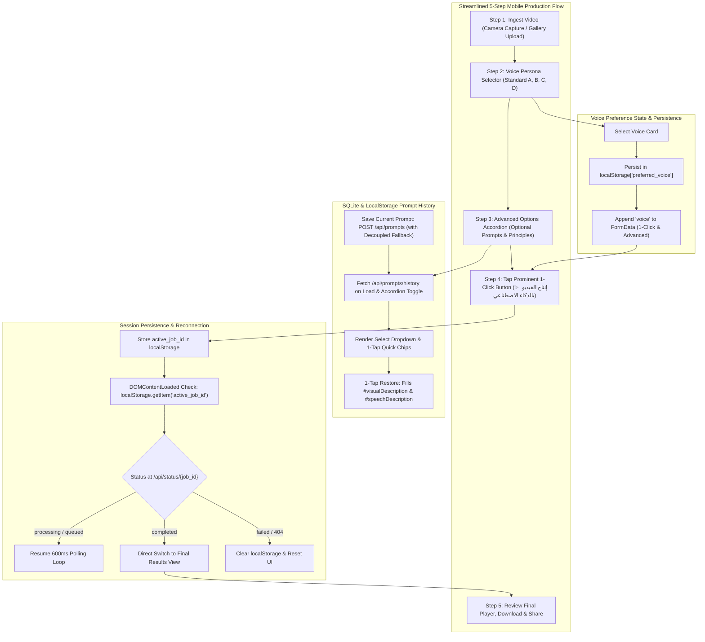

# Mobile Web Front-End & Real Estate UI/UX Studio (`web/static/`)

## 1. Overview & System Mission
The `web/static/` directory houses the client-side architecture for the **Algerian Real Estate Mobile Studio** (`استوديو عقارات الجزائر`). Engineered specifically for mobile smartphone field workflows, this interface empowers Algerian real estate agents, videographers, and property promoters to:
1. **Prominent Main-Screen Voice Selection**: Easily select from 4 specialized Arabic voice personas right on the main screen (Standard A: Female Warm, Standard B: Male Prestigious, Standard C: Male Dynamic, Standard D: Female Elegant), with automated `localStorage['preferred_voice']` persistence and direct `FormData` forwarding.
2. **Streamlined & Decluttered Mobile Flow**: Clean 5-step progressive disclosure architecture eliminating raw debug dumps and redundant controls:
   - Step 1: Video Input & Mobile Camera Recording (with clean instant preview)
   - Step 2: Voice Persona Selector (Interactive male & female radio cards)
   - Step 3: Collapsible Advanced Options (Linguistic visual & speech intent, SQLite history restoration, Production Principles)
   - Step 4: Centered 1-Click AI Production Button (**"✨ إنتاج الفيديو بالذكاء الاصطناعي"** / `#btnProduce` / `#submitBtn`)
   - Step 5: High-Definition Playback, Download, and Social Distribution
3. **Linguistic Visual & Speech Intent Directives**: Express desired visual scenes and voiceover direction in natural Arabic descriptions (e.g., luxury salon tour, balcony sea view, friendly walkthrough tone), passed directly to backend AI agents.
4. **Saved Prompts History & 1-Tap Restoration (SQLite / LocalStorage)**: View, restore, and save linguistic prompt presets with immediate 1-tap chip restoration or select dropdown bindings, backed by `GET /api/prompts/history` and `POST /api/prompts` with decoupled fallback fixtures.
5. **Mobile-Optimized Production Principles Modal**: High-contrast dark theme glassmorphism modal (`#principlesModal`) engineered for smartphone viewports (360px - 430px wide), featuring smooth touch scrolling (`-webkit-overflow-scrolling: touch`), viewport capping (`88vh` / `90vh`), and responsive form controls.
6. **Autonomous Vision & Audio Inference**: When advanced customization is left collapsed/empty, the client sends `auto_mode=true`, letting the backend AI vision agent infer property features, promotional Arabic narration, emotional tone/mood, and matching background music automatically while respecting the chosen voice persona.
7. **Session Persistence & Seamless Reconnection**: Persists in-flight processing jobs across page refreshes, browser reloads, and mobile network disconnects via `localStorage['active_job_id']`. Reconnecting sessions seamlessly resume live 600ms telemetry polling or immediately display the completed marketing cut.
8. **Emotional Tone & Vision Telemetry**: Highlights the AI-inferred emotional atmosphere (e.g. *الحالة الشعورية: فاخر وهادئ*) through dedicated spotlight cards and telemetry badges.

---

## 2. Itemized File Manifest & Responsibilities

| File | Language / Format | Primary Responsibility |
| :--- | :--- | :--- |
| [`index.html`](file:///home/pluto/projects/lok/web/static/index.html) | Semantic HTML5 (RTL) | Streamlined 5-step mobile interface, prominent voice persona radio cards, collapsible advanced accordion with linguistic prompts & SQLite history restoration, mobile principles modal, native camera inputs, live viewfinder, telemetry stepper, and result playback player. |
| [`style.css`](file:///home/pluto/projects/lok/web/static/style.css) | Modern CSS3 | Emerald & gold luxury dark UI theme, voice selector interactive radio cards, collapsible telemetry logs, high-contrast dark glassmorphism for principles modal, mobile viewport media queries (360px - 430px), prompt history chips, and responsive touch ergonomics. |
| [`app.js`](file:///home/pluto/projects/lok/web/static/app.js) | Vanilla ES2022 JavaScript | State engine, voice persona selection & persistence (`preferred_voice`), prompt history fetching & restoration (`/api/prompts/history`), prompt saving (`/api/prompts`), FormData serialization (`voice`, `visual_description`, `speech_description`), `localStorage` session persistence, automated reconnection lifecycle, and live telemetry polling. |
| [`README.md`](file:///home/pluto/projects/lok/web/static/README.md) | Markdown (English) | Complete architectural documentation, session lifecycle specification, component contract guide, and UI component reference. |

---

## 3. UI Architecture & Streamlined 5-Step Workflow



### 3.1 Prominent Voice Selector & Persona Persistence
- **Main-Screen Accessibility**: Located prominently right after the video capture section (`#voiceSelectionCard`).
- **Standardized Arabic Profiles (Google Neural TTS / Gemini)**:
  - 🎙️ **Standard A** (`ar-XA-Standard-A`): صوت أنثوي دافئ وطبيعي (Female Warm & Natural)
  - 🎙️ **Standard B** (`ar-XA-Standard-B`): صوت رجالي فخم وواثق (Male Prestigious & Confident)
  - 🎙️ **Standard C** (`ar-XA-Standard-C`): صوت رجالي حيوي وعصري (Male Dynamic & Modern)
  - 🎙️ **Standard D** (`ar-XA-Standard-D`): صوت أنثوي أنيق وهادئ (Female Elegant & Calm)
- **Local Persistence & Syncing**:
  - Saved to `localStorage['preferred_voice']`.
  - Automatically restored on application reload.
  - Two-way synced with the `#voiceSelect` control inside the advanced accordion.
  - Guaranteed inclusion: Always sent as `FormData.append('voice', selectedVoice)` for both 1-Click zero-effort dispatch and manual custom jobs.

### 3.2 UI Decluttering & Progressive Disclosure
- **Technical Log Concealment**: Replaced the bulky, continuous raw terminal dump with a sleek collapsible disclosure (`<details class="terminal-collapsible" id="terminalWrapper">`). The user receives human-readable status feedback in `#aiAgentMessage` without screen overload.
- **Header Simplification**: Stripped internal agent badges and secondary action clutter from the header to keep the mobile viewport focused on video capture.
- **De-Duplication of Actions**: Removed redundant and conflicting call-to-action buttons across the interface.
- **Single Focal Production Button**: Center-aligned, luminous luxury CTA (`#btnProduce` / `#submitBtn`):
  **"✨ إنتاج الفيديو بالذكاء الاصطناعي"** (Subtitle: *إنتاج الفيديو تلقائياً بالذكاء الاصطناعي بنقرة واحدة*).

### 3.3 Linguistic Prompts & SQLite Saved History
- **Visual Description Control (`#visualDescription`)**:
  - Arabic Label: "وصف ما تريده أن يظهر في الفيديو"
  - Purpose: Linguistic scene description steered by background vision agents.
- **Speech Intent Control (`#speechDescription`)**:
  - Arabic Label: "وصف ما تريده أن يُقال في التعليق الصوتي"
  - Purpose: Linguistic speech intent guiding neural narration.
- **History Restoration (`#promptHistorySelect` & `#promptHistoryChips`)**:
  - `GET /api/prompts/history` with 1-tap chip restoration and animated highlight feedback.
- **Save Current Prompt (`#btnSavePrompt`)**:
  - `POST /api/prompts` with decoupled local cache fallback.

### 3.4 Mobile-Optimized Production Principles Modal (`#principlesModal`)
- **Smartphone Ergonomics (360px - 430px)**:
  - **Glassmorphism Theme**: High-contrast dark theme with translucent slate card (`rgba(15, 23, 42, 0.96)`), `backdrop-filter: blur(20px)`, and emerald border accents (`rgba(16, 185, 129, 0.4)`).
  - **Touch Scrolling**: Bound with `-webkit-overflow-scrolling: touch` and `overscroll-behavior: contain`.
  - **Height Capping**: Constrained to `88vh` / `90vh`.
  - **Single-Column Mobile Responsiveness**: Zero horizontal overflow on mobile viewports.

---

## 4. Design Tokens & Visual Hierarchy (`style.css`)

```css
/* Voice Persona Radio Card Tokens */
--voice-card-bg: rgba(15, 23, 42, 0.6);
--voice-card-border: rgba(255, 255, 255, 0.12);
--voice-card-active-bg: linear-gradient(135deg, rgba(16, 185, 129, 0.14) 0%, rgba(15, 23, 42, 0.85) 100%);
--voice-card-active-border: #10b981;

/* 1-Click Luxury AI Production Gradient */
--btn-1click-bg: linear-gradient(135deg, #047857 0%, #059669 30%, #b45309 70%, #d97706 100%);
--btn-1click-glow: rgba(245, 158, 11, 0.35);

/* High-Contrast Modal Glassmorphism */
--modal-card-bg: rgba(15, 23, 42, 0.96);
--modal-card-border: rgba(16, 185, 129, 0.4);
--modal-backdrop-bg: rgba(3, 7, 18, 0.88);
```

---

## 5. REST API Integration Matrix

| Endpoint | Method | Sent from Frontend | Client Handling |
| :--- | :--- | :--- | :--- |
| `/api/health` | `GET` | None | Updates `#systemStatusChip` indicator. |
| `/api/presets` | `GET` | None | Injects cards into `#presetsSelectorGrid` inside accordion. |
| `/api/music-tracks` | `GET` | None | Injects music options into `#musicSelect`. |
| `/api/principles` | `GET` | None | Loads active production principles into `#principlesModal`. |
| `/api/principles` | `POST` | JSON payload of principles | Saves user principles in backend memory and file storage. |
| `/api/principles/reset` | `POST` | None | Restores factory default production principles. |
| `/api/prompts/history` | `GET` | None | Retrieves saved visual and speech prompt history for 1-tap restore. |
| `/api/prompts` | `POST` | JSON: `visual_description`, `speech_description`, `title` | Persists current prompt to SQLite database / local fallback. |
| `/api/jobs/create` | `POST` | `multipart/form-data`: `video`, `voice` (prominent selection), `visual_description`, `speech_description`, `auto_mode=true` (if collapsed), optional `script`, `preset`, `music` | Stores `job_id` in `localStorage`, initiates 600ms polling. |
| `/api/upload-and-process` | `POST` | `multipart/form-data`: `video`, `voice`, `visual_description`, `speech_description` | Direct synchronous fallback processing endpoint. |
| `/api/status/{job_id}` | `GET` | `job_id` in URL path | Returns live step, progress percent, logs, and final cut URL + `emotional_tone`. |
| `/outputs/mobile_cuts/*` | `GET` | None | Direct HTML5 video and keyframe image streaming. |
