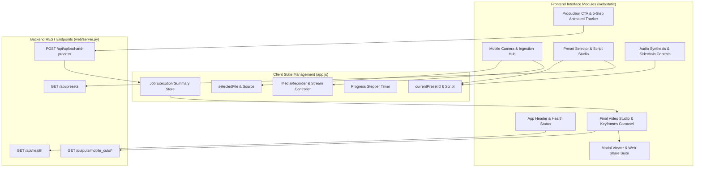

# Mobile Web Front-End & Real Estate UI/UX Studio (`web/static/`)

## 1. Overview & System Mission
The `web/static/` directory houses the client-side architecture for the **Algerian Real Estate Mobile Studio** (`استوديو عقارات الجزائر`). Engineered specifically for mobile smartphone field workflows, this interface empowers Algerian real estate agents, videographers, and property promoters to:
1. Capture high-definition on-site video footage directly using their smartphone's native camera hardware (iPhone Safari & Android Chrome) or in-browser live viewfinder.
2. Select curated Algerian real estate marketing presets (Algiers Luxury F4, Oran Seaview Villa, Constantine Commercial Store, and Furnished Rental Apartment) with automatic script synchronization and live speech pacing analytics.
3. Configure Gemini neural Arabic speech synthesis voices and dynamic background ambient music sidechain ducking (0% to 50%).
4. Track multi-stage post-production execution through an animated 5-step progress stepper.
5. Preview the exported high-definition marketing cut, inspect extracted keyframe thumbnails via interactive modal carousels, and instantly distribute media via Web Share API, WhatsApp, and Telegram.

The application adheres to clean separation of concerns, strict RTL layout ergonomics, and zero-dependency vanilla web standards for lightweight load performance.

---

## 2. Itemized File Manifest & Responsibilities

| File | Language / Format | Primary Responsibility |
| :--- | :--- | :--- |
| [`index.html`](file:///home/pluto/projects/lok/web/static/index.html) | Semantic HTML5 (RTL) | Document structure, accessible DOM hierarchy, modal dialogs, video players, and form controls for mobile capture and preset selection. |
| [`style.css`](file:///home/pluto/projects/lok/web/static/style.css) | Modern CSS3 | Luxury real estate dark UI theme, CSS custom properties, responsive breakpoints, stepper animations, and touch-target ergonomics. |
| [`app.js`](file:///home/pluto/projects/lok/web/static/app.js) | Vanilla ES2022 JavaScript | State engine, native camera/MediaRecorder management, API client bridge, script analytics, Web Share API, and UI event binding. |
| [`README.md`](file:///home/pluto/projects/lok/web/static/README.md) | Markdown (English) | Complete architectural documentation, component interface specifications, and integration guide. |

---

## 3. UI Component Breakdown & Architecture



### 3.1 Mobile Camera & Ingestion Hub
- **Native Hardware Capture**: Employs `<input type="file" id="cameraInput" accept="video/*" capture="environment">`. When invoked via the prominent **"تسجيل بالكاميرا (Record with Camera)"** button, mobile browsers (iOS Safari, Android Chrome) trigger the native system camera app with full hardware autofocus, stabilization, and HDR without requiring HTTPS/localhost permissions.
- **In-Browser Live Viewfinder**: Uses `navigator.mediaDevices.getUserMedia()` with `MediaRecorder` API. Features live video preview, camera lens flipping (`facingMode: "environment"` ↔ `"user"`), a visual pulsing recording badge, and a real-time elapsed recording timer.
- **Gallery & Drag-and-Drop Ingestion**: Secondary `<input type="file" id="galleryInput">` alongside an interactive drag-and-drop target for pre-recorded studio files.
- **Inspection Preview Player**: Displays the captured video immediately, extracting metadata (duration, file size in MB, resolution dimensions, and 9:16 vertical vs 16:9 horizontal orientation).

### 3.2 Algerian Real Estate Presets & Script Studio
- **Dynamic Catalog Ingestion**: Fetches presets from `/api/presets` on startup, automatically falling back to built-in presets if running offline or disconnected.
  1. `algiers_f4_luxury`: *شقة فاخرة F4 - الجزائر العاصمة* (Appartement F4 Haut Standing - Alger).
  2. `oran_seaview_villa`: *فيلا عصرية بواجهة بحرية - وهران* (Villa Moderne Vue sur Mer - Oran).
  3. `constantine_commercial`: *محل تجاري استراتيجي - قسنطينة* (Local Commercial Stratégique - Constantine).
  4. `rental_apartment`: *شقة مجهزة ومؤثثة للكراء* (Appartement Équipé en Location).
- **Interactive Script Editor**: Single-click preset injection populates the script textarea. Features an instant reset button, clear button, and real-time analytics bar tracking word count, character count, and estimated voiceover speech duration (calibrated at ~2.4 Arabic words/second).

### 3.3 Audio Synthesis & Dynamic Ducking Controls
- **Voice Selection**: Dropdown configuring neural TTS engines:
  - Official Google Gemini neural personas with Arabic fluency: `Aoede` (luxury real estate feminine), `Charon` (deep authoritative masculine), `Kore` (warm residential feminine), `Fenrir` (energetic commercial masculine), and `Puck` (youthful upbeat).
  - Standard Arabic mapping: `ar-XA-Standard-A` → `Aoede`, `ar-XA-Standard-B` → `Charon`.
- **Open-Source Royalty-Free Music**:
  - `luxury_piano`: Gymnopédie No. 1 (Erik Satie, Public Domain / CC0).
  - `acoustic_guitar`: Solo Acoustic Guitar (Jason Shaw, CC-BY 3.0).
  - `ambient_meditation`: Acoustic Meditation (Jason Shaw, CC-BY 3.0).
- **Sidechain Ducking Slider**: Range `0.05` to `0.50` (5% to 50%, default 25%). Controls the dynamic compression threshold that dips the background music smoothly under spoken narration.

### 3.4 Multi-Stage Animated Processing Stepper & Live AI Agent Telemetry
Visual progress tracker and live AI agent feed activated when the user clicks **"إنتاج الفيديو التسويقي (Produce Marketing Video)"**:
- **Live AI Agent Status Banner**: Real-time state indicator reflecting the active processing milestone.
- **Real-Time Telemetry Log**: Terminal-style stream updating live as the AI agent completes keyframe extraction, neural voiceover synthesis, and ducking assembly.
- **Multi-Stage Stepper**:
  - **Step 1**: رفع واستلام الفيديو من الهاتف (Uploading & probing video from phone...)
  - **Step 2**: تحليل واستخراج لقطات المعاينة (Analyzing & extracting keyframes...)
  - **Step 3**: توليد التعليق الصوتي العصبي عبر Gemini TTS (Synthesizing promotional voiceover...)
  - **Step 4**: دمج الموسيقى مفتوحة المصدر وخفض الصوت التلقائي (Ducking ambient music & assembling final cut...)
  - **Step 5**: اكتمل الإنتاج بنجاح! (Production Complete!)

### 3.5 Delivery, Playback & Social Sharing
- **Final Cut Video Player**: HTML5 video playback with native controls, loop capability, and playsinline attributes.
- **Keyframes Thumbnail Carousel**: Horizontally scrollable carousel displaying timestamped keyframe snapshots extracted during FFmpeg analysis. Clicking any keyframe opens a high-resolution modal inspection view with a direct download link.
- **One-Touch Distribution**:
  - `navigator.share()` integration for native operating system sharing to WhatsApp, Instagram Stories, and TikTok.
  - Dedicated quick-share action chips for WhatsApp Web/App, Telegram, and instant clipboard URL copying.
  - Direct download links for the rendered video (`cut_<job_id>.mp4`) and the isolated voiceover audio track (`narration_<job_id>.wav`).

---

## 4. Visual Patterns, Design Tokens & Styling Framework

### 4.1 Theme Design Tokens (`style.css`)
```css
--bg-dark: #070b14;                  /* Deep slate canvas background */
--bg-surface: #0b1120;               /* Primary container surface */
--card-bg: #111a2e;                  /* Standard card background */
--card-bg-elevated: #16223b;         /* Interactive card background */

--emerald-500: #10b981;              /* Primary emerald accent */
--emerald-400: #34d399;              /* Hover & highlight emerald */
--gold-500: #f59e0b;                 /* Real estate luxury gold */
--gold-400: #fbbf24;                 /* Gold text highlight */
--cyan-500: #06b6d4;                 /* Audio & telemetry cyan */
--rose-500: #f43f5e;                 /* Live recording indicator */
```

### 4.2 Typography & RTL Standards
- **Arabic Body & Headings**: Google `Cairo` font (weights 400, 500, 600, 700, 800, 900) ensures crisp readability for Arabic calligraphic curves and property descriptions.
- **Numeric & Metric Badges**: `Inter` font family for timestamps, byte counters, aspect ratios, and numerical statistics.
- **Directionality**: Document root is set to `dir="rtl"`, aligning flex containers, padding, and form controls to natural right-to-left scanning patterns.
- **Mobile Touch Targets**: All interactive elements (buttons, inputs, cards) maintain a minimum touch target height of 48px to prevent touch collisions on mobile screens.

---

## 5. API Contracts & Backend Integration

The client communicates with the Starlette backend (`web/server.py`):

| Endpoint | Method | Payload | Expected Client Response |
| :--- | :--- | :--- | :--- |
| `/api/health` | `GET` | None | `{"status": "ok", "service": "mobile-video-processing-api"}` |
| `/api/presets` | `GET` | None | Array of presets: `[{"id": "...", "title_ar": "...", "title_fr": "...", "description": "..."}]` |
| `/api/upload-and-process` | `POST` | `multipart/form-data`: `video` (file), `script` (str), `preset` (str), `voice` (str), `duck_level` (float) | JSON Execution Summary: `job_id`, `video_url`, `narration_audio_url`, `duration`, `resolution`, `keyframes`, `metadata` |
| `/outputs/mobile_cuts/*` | `GET` | None | Direct static MP4 and WAV streaming via Starlette StaticFiles |

---

## 6. Integration Notes & Operational Caveats

1. **Camera Recording Reliability on Mobile**:
   Using HTML5 `<input type="file" accept="video/*" capture="environment">` is the most resilient cross-platform pattern for mobile web. It works seamlessly across iOS Safari and Android Chrome regardless of whether the site is served over HTTPS or plain HTTP (LAN IP).
2. **MediaDevices Viewfinder Origin Constraints**:
   The in-browser live viewfinder (`navigator.mediaDevices.getUserMedia`) requires a Secure Context (`https://` or `http://localhost`). When accessed over a raw LAN IP (`http://192.168.x.x`), the browser may restrict getUserMedia; `app.js` detects this condition gracefully and directs the user to the Native Camera button.
3. **Web Share API Fallback**:
   On desktop browsers or mobile browsers without Web Share support, clicking **"مشاركة الفيديو"** automatically falls back to copying the absolute video URL to the clipboard and displaying an animated toast notification.
